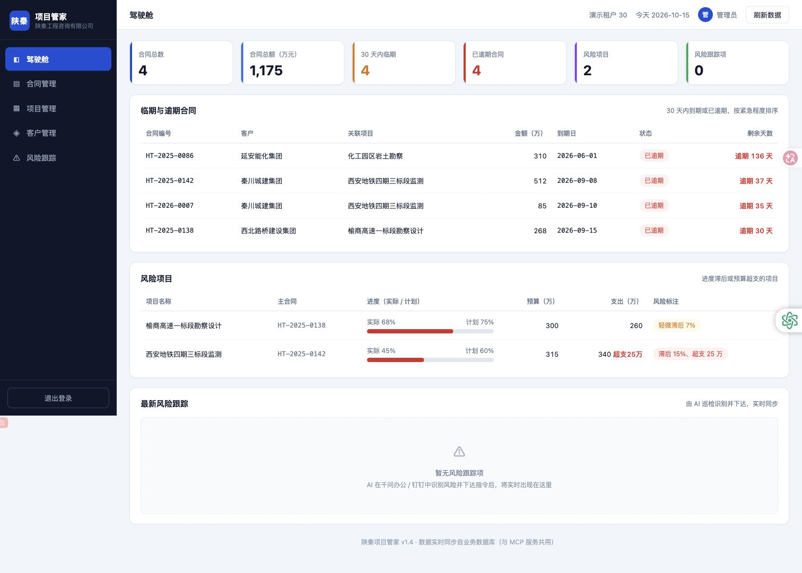
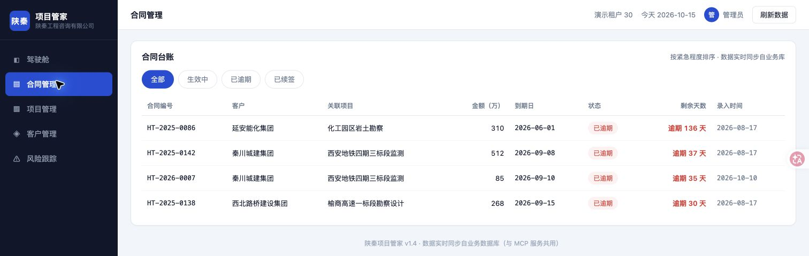
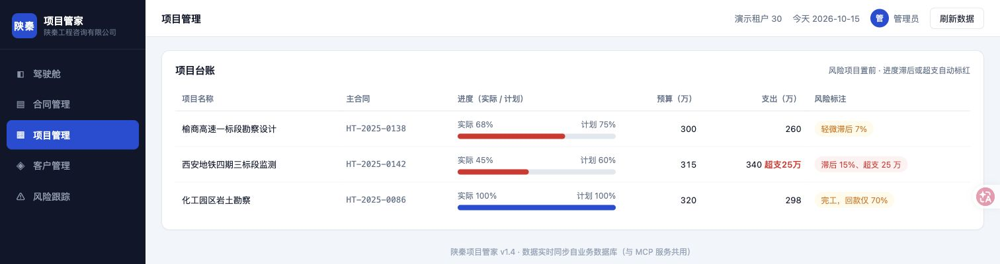
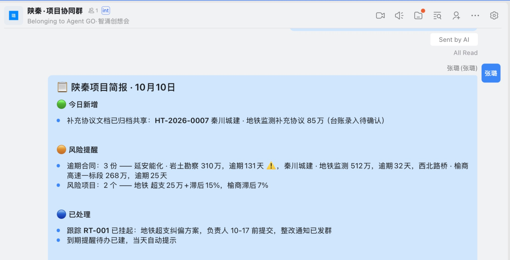
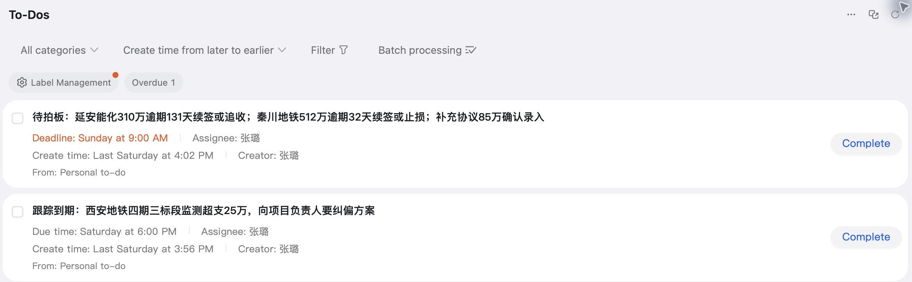
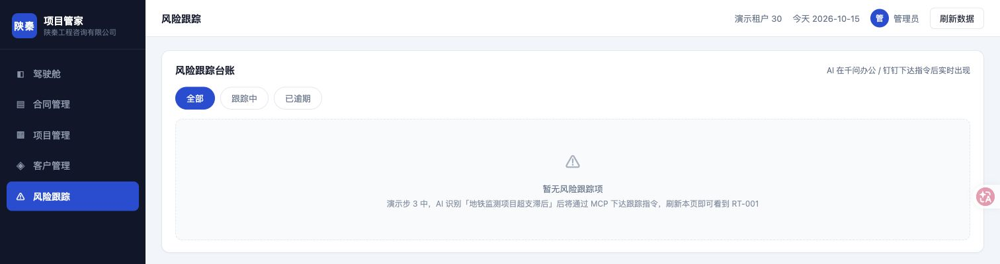

# Qwen Office × DingTalk: A Shanqin Case Study

**English** · [简体中文原文](04_final_report.md) · [English / 简体中文 / 繁體中文 HTML](04_final_report.html)

> English edition of the corrected report. Original evidence identifiers and all six screenshots are retained. This translation is not additional independent evidence.

Report date: 14 October 2026\
Purpose: internal management discussion and decisions on further validation\
Practitioner: Leo Zhang; practice date: 10 October 2026

## I. Executive summary

**Run a limited, measurable follow-up evaluation. This practice does not yet justify deployment or wider use.** With simulated data and preset workflows, Qwen Office called business-system and DingTalk tools to connect document reading, field extraction, tracking registration and briefing distribution. The most useful value to test is reduced repeated preparation and copying as information moves from documents into work records and collaboration channels. [E04, E07, E11, E20]

The evidence also sets clear limits. This was a one-person demonstration. I observed the AI complete contract entry in Qwen Office without clicking the supplementary agreement myself; the specific write call has not been located in the reviewed records. A tracking item was created and read back, but a later inspection returned an empty list. The assistant attributed this to a missed day-seven boundary; the raw records establish neither that cause nor a successful fix. Of four scheduled inspections, two have completion records and two execution errors. This supports the feasibility of selected steps, but does not validate a complete management workflow or sustained reliability. [E01, E05, E07–E10, E15]

**Numerical accuracy and sound management judgement need separate acceptance checks.** The customer analysis cited ledger figures while also asserting, without independent support, that renewal formalities had not been completed. For project reporting, reviewers must check both the numbers and whether the conclusions go beyond the source material. [E12, E23]

Prioritise document field extraction and draft project-status and decision briefings, compared with manual work using the same standard. If quality is acceptable, test handoffs between two people. Any expansion should depend on net improvement after review, rework and maintenance, together with permitted tools, data and access. The materials contain no measured efficiency gains, cost-benefit results or department-wide rollout outcomes. [E21–E24]

## II. Background and scope

On 10 October 2026, I attended a Qwen Office event on behalf of the company and followed the event materials to try office collaboration scenarios based on the Shanqin project. I later demonstrated some results to my manager and was asked to prepare this report. It examines changes to office workflows and the value of further validation, not overall product competitiveness, software development or Agentic SDLC practice. [U1]

The practice used a demo tenant, preset contracts and project data. The packages comprised environment preparation and six business skills: contract entry, risk review, risk tracking, business briefings, customer decision support and scheduled inspections. One person exercised these workflows; coverage does not mean every step passed acceptance. The AI entered the contract while I watched in Qwen Office. The collaboration group was not used for real multi-person task handling. [E01–E05; U3]

The analysis reviewed three Qwen drafts and the same-day retrospective, then checked the locally saved main conversation, three inspection execution records, and run logs and group messages retrieved on 14 October. It also read seven skill packages and the actual agreement. Draft claims that conflicted with raw returns or overstated the evidence were corrected. These are local records of historical states; the historical analysis did not query or operate remote systems again. This version adds read-only business-screen captures from 15 October, with scope stated in each caption. [Source index in the appendices]

Four categories are distinguished: A, facts directly supported by material; B, observations from limited practice; C, evidence-based analysis; and D, unimplemented proposals or hypotheses. Manual methods described below are proposed comparators, not descriptions of HSBC's current processes. No on-site manual timing data was collected.

<!-- screenshot:UI-06:start -->

**Figure 1. Shanqin Project Manager dashboard**

Business demo system /demo30/; read-only capture on 15 October 2026.

The screen shows 4 contracts totalling RMB 11.75 million, 2 at-risk projects, 0 risk-tracking items, and contract and project details.

Values show the demo tenant on 15 October, not business benefits or historical run statistics. The 'due within 30 days' card shows 4 while the contracts below are marked overdue. Its counting definition is unverified; do not interpret it as four future expiries. References: E01, E06, E20.
<!-- screenshot:UI-06:end -->

## III. Scenario analysis

### 1. Read and enter contract information

The task was to turn contract material in a group into business-ledger fields. A manual comparator would locate and read the document, enter fields and review them. The assistant found the online agreement via group messages, read it, listed the number, customer, project, amount and expiry date, separately explained its status, then requested confirmation. Core values, including RMB 850,000 and expiry on 10 September 2026, matched the input. [A: E04]

This connects reading, extraction and a confirmation request. However, the input was a short template embedded in a skill and created during setup; unfamiliar contracts, scans, conflicting versions and missing fields were not tested. I did not click the supplementary agreement and observed the AI complete entry in Qwen Office; the contract also appeared in the later ledger. Retain AI entry as an observed outcome, while noting that its write call has not been located in the reviewed main conversation. Confirmation context and execution receipts are still needed to validate the full write process. [A/B: E04–E05; U3]

For technology projects, the useful idea is to extract verifiable handoff fields from defined materials, attach source references and obtain human confirmation. A further test with new material could measure field accuracy, completeness and review effort. Whether this saves time is unknown.

<!-- screenshot:UI-01:start -->

**Figure 2. Contract HT-2026-0007 in the ledger**

Business demo system /demo30/contracts; captured on 15 October 2026.

Visible fields include the contract number, Qinchuan Urban Construction Group, RMB 850,000, expiry 2026-09-10 and entry date 2026-10-10.

This is the ledger state at the later capture. The screenshot does not show the write process; the account that I watched AI entry throughout and did not click the agreement remains based on my correction U3. References: E04, E05, U3.
<!-- screenshot:UI-01:end -->

### 2. Summarise risks and decisions needed

The task was to turn separate ledgers into a status briefing for discussion. The assistant read three data sources—contracts, at-risk projects and tracking items—generated 'new', 'risks', 'handled' and 'decisions needed' content, and posted it to the group. Readback showed three pending decisions and distinguished 'agreement archived' from 'ledger entry awaiting confirmation'. These are recorded outputs. [A: E11]

The useful feature is making status and responsibility explicit. Card colours, @mentions and formatting are ordinary features; no evidence shows improved decision quality or response speed. The risk API already returned days overdue, overspend and progress gaps. The model mainly called tools, aggregated data and expressed results; backend rule calculations cannot all be credited as independent risk detection by the model. [A/C: E06, E11, E13]

This is a suitable first test for draft project briefings, with limits on interpretation. Contract expiry does not establish payment arrears, nor is contract value necessarily an amount to recover. Planned progress of 60% versus actual progress of 45% is a 15-percentage-point gap. Matters needing business judgement should be presented for confirmation. [C: E23]

<!-- screenshot:UI-04:start -->

**Figure 3. Progress, budget and spending in the ledger**

Business demo system /demo30/projects; read-only capture on 15 October 2026.

The metro-monitoring project shows 45% actual progress against 60% planned, a budget of RMB 3.15 million and spending of RMB 3.40 million. The screen also shows the Yushang project's progress gap.

This read-only capture from 15 October does not replace the 10 October API return. The screen's '15% behind' means a 15-percentage-point gap. Risk labels come from the business system and cannot all be credited to independent model detection. References: E06, E23.
<!-- screenshot:UI-04:end -->

<!-- screenshot:UI-02:start -->

**Figure 4. DingTalk's 10 October project briefing (excerpt)**

Local DingTalk client, 'Shanqin · Project Collaboration' group; captured on 15 October 2026.

Visible sections include 'new today', 'risk alerts' and 'handled'. This briefing still marks the supplementary agreement as 'ledger entry awaiting confirmation'.

This historical message in the current client alone does not establish the initial version or later closure. The group was a one-person demonstration; 'automatic prompt' in the message does not verify reminder delivery. References: E07, E08, E11.
<!-- screenshot:UI-02:end -->

### 3. Register instructions and notify

The task was to turn 'submit a corrective plan within a week' into a trackable item. Records show the assistant created RT-001 with a project, requirement, deadline and 'project owner', then created a personal to-do, sent a correction notice and read the group message back. Compared with the proposed manual workflow, it generated multiple registrations and notification texts. [A/B: E07]

This connects an instruction to work items, but does not demonstrate accountable follow-through. The owner remained a generic role and the to-do was assigned to the demonstrator. There is no record of another person accepting, executing, reporting on or closing it. A to-do with a deadline does not prove notification delivery. [A: E01, E08]

The main conversation read RT-001 at 16:02, but the inspection subtask returned an empty list at 16:11. The records do not establish whether this was caused by a different tenant or connection context, a data reset, persistence or something else. First test how records, to-dos and notifications for one item correspond in an isolated sandbox, then involve a real recipient. Successful sending alone is insufficient for acceptance. [A/C: E09]

<!-- screenshot:UI-03:start -->

**Figure 5. Decision and corrective-plan follow-up to-dos**

Local DingTalk client, To-Dos list; captured on 15 October 2026.

Two practice to-dos, assignees and deadlines are visible. The decision item shows Sunday 9:00 AM and the corrective-plan follow-up Saturday 6:00 PM. Both still have a 'Complete' button.

The screenshot supports the existence of to-dos, not reminder delivery, owner acceptance or business closure. Interpret relative dates with the capture date and original records; this is not a new effectiveness test. References: E07, E08.
<!-- screenshot:UI-03:end -->

<!-- screenshot:UI-05:start -->

**Figure 6. Risk-tracking page shows 'No risk-tracking items'**

Business demo system /demo30/risks; read-only capture on 15 October 2026.

The 'All' filter is selected. The page says 'No risk-tracking items'; RT-001 is not visible.

This current view on 15 October does not prove RT-001 was deleted or explain the two different reads on 10 October. Alongside the still-existing to-dos, it shows why each work object's status needs separate checks. References: E07, E09, E10.
<!-- screenshot:UI-05:end -->

### 4. Daily inspections and exception handling

The task was to query risks repeatedly and notify only when action was needed. Qwen Office created a daily 09:00 task and immediately triggered one demonstration. Of four subsequent scheduled runs, 11 October logged too_late, 12 October sleep, and 13 and 14 October completion. The latter two group messages appeared at 09:11:57 and 09:11:38. Causes are described only to the extent supported by logs. [A: E15–E16]

The earlier retrospective's failure explanation most needs correction. On 10 October the inspection API had already returned an empty tracking list, yet the assistant attributed this to 'exactly day seven being missed', changed the prompt and confirmed scheduling remained enabled. No successful retest under the same data-present conditions is recorded. **An updated configuration and an enabled task do not prove that the business issue was fixed.** [A/C: E09–E10]

These inspections merit further evaluation, but should not yet be the sole protection for critical deadlines. No group message may mean no risk or no execution. Validate business notifications, operational health, delay, failure alerts and human takeover separately. Only this group and available logs were checked; this does not establish that the platform lacks other alert channels. [C/D: E17]

## IV. Key findings

### 1. Value at the handoffs between tools

Qwen interprets requests, organises content and calls tools. The business system supplies records and some rule calculations. DingTalk holds online documents, group messages and personal to-dos. Qwen Office creates scheduled tasks. Standalone AI can also summarise manually supplied material; DingTalk adds paths for acquiring inputs and placing outputs into collaboration objects, creating the possibility of less manual copying. [A/C: E20]

No same-task comparison of standalone AI and AI connected to a platform was performed, so this additional value cannot be quantified. Existing templates or ordinary automation should also be compared if they can perform fixed-rule tasks more reliably. [D: E21–E22]

### 2. Validate each control separately

The demonstration contains useful positive observations: confirmation requested after contract extraction, customer analysis kept in the conversation, cross-organisation reading denied, invalid @mention format blocked, and some messages read back. [A/B: E03, E13–E14]

These controls serve different purposes. Format validation is not business approval. A skill's instruction not to post to a group does not prove all conflicting instructions are blocked. One confirmation request does not prove confirmation always matches the eventual write. Not clicking the agreement does not establish that AI acted without authorisation; inspect the specific confirmation and execution sequence. Test refusal, changes, retries, wrong destinations and insufficient permissions separately. [C/D: E14]

### 3. Check both fields and interpretation

The customer-analysis API returned business amounts, project counts, expiry dates and status. The assistant further asserted that renewal or extension formalities were incomplete and revenue lacked contractual protection. The input did not establish these conclusions; customer resource priorities also lacked complete payment and return information. Reading material correctly does not guarantee a valid business interpretation. [A/C: E12]

Likewise, an unsupported diagnosis of the inspection problem entered the retrospective and was then described as fixed in a draft. AI summaries should retain raw returns and the basis for human corrections. One AI summary cannot independently substantiate another. [C: E10]

### 4. Feasibility is not proof of benefit

| Level of judgement | Current basis | Conclusion |
| --- | --- | --- |
| Functions work | Records of document reading, tracking writes, to-do creation and message readback | Several functions worked under those conditions |
| Scenario feasibility | Sequential operations with simulated data, one person and preset skills | Selected paths are feasible; end-to-end gaps remain |
| Benefits validated | No manual baseline, common quality scoring or handoff-effectiveness measures | Not yet verified |
| Readiness for wider use | Bank environment, multi-person use and sustained operations not tested | Not yet verified |

Seven skill packages provide reusable workflows, but contain example dependencies such as demo groups, people and old dates. Rollout also costs parameter migration, permission confirmation, testing and ongoing maintenance; no such cost data was collected. [E19, E21, E24]

## V. Relevance to bank technology work

Candidate uses are extracting project information, summarising status, preparing decisions and handing off tasks. These could use AI's language and information-organisation abilities, while still requiring clear business objects, final judgement, recipients and accountability. They are use-case hypotheses, not evidence of problems at this bank or approval to use the products. [C/D: E22, E24]

Internal usability requires a separate assessment. Business or project owners should define information standards, acceptance criteria and final responsibility. Technology teams should design tests, record failures and human takeover. Security and data owners should confirm permitted tools, data categories, transfer, retention and access. Platform teams should confirm identity, permissions, interfaces, audit, scheduling and support. Applicable internal processes remain to be confirmed; this report does not infer existing architecture or control gaps. [D: E24]

Key limitations are a single preset sample, a one-person demonstration, no benefits baseline and unexplained tracking-state differences. Real material quality, conflicting definitions and exceptions add review cost. Even if generation becomes faster, check whether final delivery still meets requirements and whether data-entry effort has merely become more time-consuming checking.

## VI. Recommendations

### 1. Start with two clearly scoped tasks

A manager should designate a task owner and arrange a validation window of no more than two weeks in a permitted environment, using synthetic material for field extraction and project-briefing drafts. This is a proposed timebox, not an agreed plan or promise of results. Humans review every output first. Any later use of de-identified or real internal material must remain within the actually permitted scope. [D]

Do not initially prioritise customer business decisions, unattended critical reminders or more presentation formatting. Two-person handoffs can be the next stage, testing whether the collaboration platform adds value.

### 2. Compare complete tasks to one standard

Prepare six pairs of equally difficult but different tasks per scenario: 12 pairs and 24 executions across two scenarios, with 12 manual and 12 AI-assisted runs. Randomly allocate methods and alternate execution order, avoiding the memory advantage of manually completing material before asking AI to repeat it. Use the same input scope and final acceptance criteria; record practice and setup separately from formal timing. This small sample supports initial observation, not department-wide benefit projections. [D]

Keep four core measures: active human time, elapsed time to acceptance, output completeness/accuracy and revision rounds. Include prompting, review, confirmation, copying, rework and manual recovery after failure; record learning and maintenance costs separately. Score first drafts and final quality separately, retaining failed and abandoned cases. Do not invent baseline values or target savings before data exists. [D]

If initial results are acceptable, use new tasks to compare AI drafting followed by manual copying with AI connected to the collaboration platform, separating integration benefits from generation benefits. A two-person test should check that owner, deadline, item ID and acceptance information are complete.

### 3. Decide whether to expand or stop

Before expanding, require quality against the same standard, net improvement after review and maintenance, traceable error handling and confirmed conditions of use. Critical errors must not escape acceptance, and unauthorised writes or distribution must not occur. The task owner should set time-improvement criteria and tolerances for non-critical errors before seeing results. [D]

If drafts help but integration costs offset the gains, retain drafting assistance alone. If state is inconsistent, critical items are silently missed or responsibility cannot be established, stop the relevant automatic actions and restore manual handling. An inconclusive evaluation may be ended without widening scope just to prolong the trial.

## VII. Appendices

### Appendix A. Case evidence

| Item | Most direct evidence | Supported conclusion and limits |
| --- | --- | --- |
| Contract extraction | R1 lines 320, 325; M5 | Source and core values match; confirmation requested; one preset template |
| Subsequent contract entry | User correction U3; R3 line 16, R5 line 73 | I observed AI entry without clicking the agreement; ledger record exists, but the write call and confirmation sequence need checking |
| Tracking and distribution | R1 lines 380, 387, 395, 438 | Write, to-do creation and group-notice readback recorded; no multi-person acceptance or closure |
| Tracking-state discrepancy | R1 line 438 versus R2 line 33 | Same-day reads returned one then zero items; cause and connection context unknown |
| Prompt revision | R1 lines 513–525 | Updated and found enabled; this does not establish the cause or a successful retest |
| Briefing and interpretation risk | R1 line 459; lines 415, 418 | Briefing readable in the group; some customer-analysis judgements exceed the input |
| Inspection reliability | R5 lines 61, 69; R3, R4 | Two errors and two completions in four scheduled runs; no estimate of overall product reliability |
| Demo limits | U2; K1–K7; M7 | One person, demo environment, seven skills; M7 shows an entry point to material, not operation results |

### Appendix B. Priority open questions

1. Why did reads of RT-001 differ? Match tenant, connection context and server-side change records; prompt adjustments alone are insufficient.
2. Which call entered the supplementary agreement, with what confirmation and receipt? I have confirmed watching the AI enter it; execution records still need to be matched to the ledger.
3. Were due-date reminders actually delivered, and do missed runs have other alert channels? Neither creation nor silence in the group establishes delivery.
4. Which two actual tasks merit a trial, who accepts the results, and which tools and material are permitted? The manager and relevant owners must decide.
5. What are the event's exact official name and organiser? The group display name differs from an existing article; this does not affect the scenario analysis.

### Appendix C. Suggested evaluation records

| Measure | What to record | Current status |
| --- | --- | --- |
| Human effort | Minutes spent preparing, operating, reviewing, revising, copying and recovering | Not measured |
| Elapsed time | From complete inputs to final acceptance, identifying system and human waiting separately | No measured comparator |
| Quality | Field/fact coverage, critical errors and unsupported judgements; draft and final scored separately | No common scoring |
| Rework | Revision rounds, failures, manual recovery and maintenance effort | Not systematically recorded |
| Handoff | Item ID, owner, deadline, consistent status and receipt confirmation | One person; multi-person use not tested |

Create separate cases for date boundaries, empty data, read failures, wrong groups, duplicate submissions and changes after confirmation. Report paired task differences, overall median and range, with failure cases. The proposed sample size and timebox are not measured results.

### Appendix D. Sources and traceability

M1–M3: Qwen-generated report draft, practice-material and fact list, and key findings and management implications dated 2026-10-14. M4: 'Shanqin Three-End Collaboration Demo Retrospective', 2026-10-10. M5: 'Supplementary Agreement' in the demo working directory. M7: screenshot of a handbook card in the group. K1–K7: seven Shanqin skill packages.U1: my requirements for this report; U2: clarification that this was a one-person demonstration; U3: my explicit correction: 'I did not click the supplementary agreement. The AI entered the contract, and I watched Qwen Office throughout.'

R1: local main-conversation record, `3348c252-83d0-43c6-a838-030e53705d0c.jsonl`; R2: immediate inspection on 10-10, `b55b6d62-aae9-4b47-8e0d-7bef9bdc2355.jsonl`; R3: inspection on 10-13, `81da9cc9-9185-4183-8d8d-76e720f8802e.jsonl`; R4: inspection on 10-14, `e22eafc5-9da8-4339-9bcc-2903cbcf2384.jsonl`; R5: material review on 10-14, `bda09640-0b4e-4605-97e6-208a3b86c468.jsonl`.

E numbers refer to the accompanying Evidence Matrix and Key Findings (`02_evidence_matrix.md`). Full paths, review scope and file fingerprints are in the Material Inventory (`01_material_inventory.md`) and evidence directory. See `03_management_analysis.md` for independent analysis and the measurement proposal, and `05_open_questions.md` for the complete open-question list. Original materials are unchanged.
